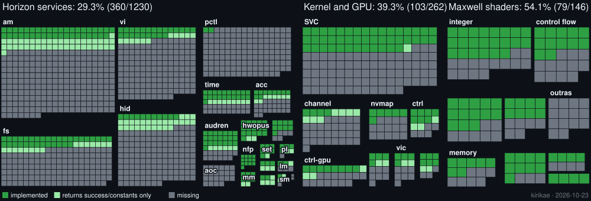

<div align="center">

# Kirikae

**A static recompiler that turns Nintendo Switch executables into native PC programs, written in Rust.**

<sub><i>切り替え (kirikae): Japanese for "switching over"</i></sub>

<br>

[](https://github.com/Cor3Duo/kirikae/actions/workflows/ci.yml)
[](#license)
[](https://www.rust-lang.org)
[](#requirements)
[](#requirements)
[](https://cranelift.dev)
[](https://github.com/Cor3Duo/kirikae/releases/latest)
[](#about)

[](docs/progress/index.html)
[](docs/progress/index.html)
[](docs/progress/index.html)
[](docs/progress/index.html)

<br>

<a href="docs/progress/index.html"></a>

<sub>Every square is a Horizon service command, kernel SVC, GPU driver ioctl or Maxwell shader instruction:
green is implemented, light green only returns success or constants, gray is missing.
<a href="docs/progress/index.html">Full table</a> · <a href="docs/progress/history.html">History</a></sub>

</div>

<br>

> [!WARNING]
> **Early preview.** Kirikae already plays complete commercial games, but it has only been tested on a
> handful of them: expect crashes, missing services and rendering bugs, and please
> [report them](https://github.com/Cor3Duo/kirikae/issues/new/choose).

> [!IMPORTANT]
> Only use games dumped from **your own console**. Kirikae ships, downloads and decrypts no game files:
> it only reads dumps that are already decrypted, the code is translated and compiled on the player's
> machine, and the resulting executable must not be shared. See [LEGAL.md](LEGAL.md). Kirikae is not
> affiliated with Nintendo.

<details>
<summary><b>Table of contents</b></summary>

- [Highlights](#highlights)
- [How it works](#how-it-works)
- [Requirements](#requirements)
- [Preparing a game](#preparing-a-game)
- [Getting started](#getting-started)
- [Features](#features)
- [Configuration](#configuration)
- [Controls](#controls)
- [Progress report](#progress-report)
- [Project layout](#project-layout)
- [Status](#status)
- [About](#about)
- [License](#license)

</details>

## Highlights

| | |
| --- | --- |
| 🦀 **Rust end to end** | The runtime (kernel, services, GPU, audio and video) is the biggest and most bug-prone part, which is exactly where Rust helps the most. |
| 🎯 **One source of truth for the CPU** | Each ARM64 instruction is lifted once into a small IR ([`ir.rs`](crates/a64/src/ir.rs)) and every operation is a function in [`ops.rs`](crates/a64/src/ops.rs). The interpreter uses them directly; the Cranelift backend is tested against them on thousands of random inputs. |
| 🛡️ **No `unsafe` in generated code** | The whole 39-bit guest address space is reserved up front and every access goes through a mask: a bad game pointer page-faults, it never corrupts host memory. |
| 🔁 **Fallback, not crash** | Code that static analysis could not find (jump tables, vtables) runs in the interpreter, and the executable records where, so the next build compiles it too. |
| ⚡ **Fast builds** | Cranelift compiles a whole game in parallel, in well under a minute on a desktop CPU. |
| 📜 **Permissive license** | MIT or Apache-2.0, with no GPL code. References are Switchbrew, Ryujinx (MIT), envytools (MIT), NVIDIA's open GPU docs and the Arm ARM. |

## How it works

```
 .dnsp / ExeFS / .nso / .nro ──► loader ──► modules (rtld, main, sdk, subsdk*) at their guest addresses
                                  │
                                  ▼
                             discover ── entry points: module starts, relocations, dynamic symbols,
                                  │      BL targets, ADR, ADRP+ADD
                                  ▼
                     lift (a64) ── IR per instruction ◄── the same IR the interpreter runs
                                  │
                ┌─────────────────┴─────────────────┐
                ▼                                   ▼
   clif (default): Cranelift → .obj     rust_backend: Rust → rustc
   in parallel, 1024 functions per .obj (reference, small programs)
                └─────────────────┬─────────────────┘
                                  ▼
          cargo ── game.exe = translated code + kirikae-rt + the original executable embedded
```

At run time `kirikae-rt` reserves guest memory, maps the modules, stack and TLS, and calls the entry
point. Direct calls become native calls; indirect ones go through a dispatcher that uses the
recompiled function when there is one and the interpreter when there is not. The runtime implements
the Horizon kernel (threads, synchronization, memory), the system services, the GPU (the Maxwell
command processor on top of Vulkan, with shaders translated to SPIR-V), audio and the video decoders.

## Requirements

- Windows 10/11 x64 and a GPU with **Vulkan 1.3**.
- [Rust](https://rustup.rs) (`cargo`) and the MSVC linker (Visual Studio Build Tools with *Desktop
  development with C++*): games are compiled on your machine. The first build downloads the runtime's
  dependencies through Cargo.
- A **decrypted** dump of a game you own (see [Preparing a game](#preparing-a-game)).

Linux x64 also works (X11 or Wayland), with Rust, a C toolchain and the ALSA and udev headers
(Fedora: `sudo dnf install gcc pkgconf-pkg-config alsa-lib-devel systemd-devel vulkan-loader`;
Debian/Ubuntu: `sudo apt install build-essential pkg-config libasound2-dev libudev-dev libvulkan1`).
Gamepads are read through evdev, so your user needs access to `/dev/input` (the default on desktop
distributions).

## Preparing a game

Kirikae never decrypts anything, so it needs the game's files already extracted. A homebrew dumper
running on **your own console** (for example nxdumptool) can dump a game's ExeFS and RomFS; put them in
one folder:

```
my-game/
├── exefs/        main, main.npdm, rtld, sdk, subsdk0...
└── romfs/        the game's files, as dumped (or romfs.bin, a RomFS image)
```

Then pick the folder in the GUI (**Add game folder...**) or run `kirikae build my-game -o out`. The
first build packs `romfs/` into `my-game/romfs.bin` (delete it to rebuild), and the title ID comes from
`main.npdm`. Also accepted: a `.dnsp` (a PFS0 holding the program NCA in plaintext), a lone `.nso` and
homebrew `.nro` files.

> [!NOTE]
> Updates and DLC are not supported yet: dump the base game. `kirikae dev extract <dump> <folder>`
> turns any accepted dump into the folder layout above.

## Getting started

### Download

Grab the latest `kirikae-<version>-windows-x64.zip` from [Releases](https://github.com/Cor3Duo/kirikae/releases/latest)
and extract it anywhere: it holds `kirikae-gui.exe`, `kirikae.exe` and the `runtime/` sources games are
compiled against (keep them together). You still need Rust and the MSVC build tools, see
[Requirements](#requirements). To build from source instead, see [Command line](#command-line).

### Graphical interface

Run `kirikae-gui.exe`, pick (or drag in) the game files and an output folder, and press **Recompile**.
Progress shows up in the log, and every finished game gets a button to open its folder. The GUI drives
the `kirikae.exe` sitting next to it.

### Command line

```bash
cargo build --release -p kirikae -p kirikae-gui

kirikae build game.dnsp -o out                        # recompile a whole game into out/game.exe
kirikae build game.dnsp -o out --profile run.profile  # also compile what a previous run interpreted
kirikae build game.dnsp -o out --plugin my-crate      # link a crate whose install() runs first
KIRIKAE_STATS=1 out/game.exe                          # fps, GPU work, native calls vs interpreted

kirikae info game.dnsp                                # modules, segments and decoder coverage
kirikae testgen hello.nro && kirikae run hello.nro    # built-in test program, interpreter only
kirikae emit hello.nro                                # print the generated Rust (Rust backend)
kirikae dev syms game.dnsp nvn                        # exported functions whose name contains "nvn"
kirikae dev module-dump game.dnsp sdk sdk.bin         # a module's loaded image, for disassembly
```

> [!TIP]
> On Windows, point `CARGO_TARGET_DIR` at a short folder if the project lives in a long path: the MSVC
> linker fails on paths over 260 characters.

### Release package

`python tools/package_release.py` builds `kirikae.exe` and `kirikae-gui.exe` and packs
`dist/kirikae-<version>-windows-x64.zip`, with the runtime sources under `runtime/` (games are compiled
against them; `KIRIKAE_RUNTIME=<kirikae-rt folder>` points somewhere else).

## Features

**Profile-guided coverage.** The generated executable records every address where the interpreter
had to take over and writes the list to `<name>.profile` every 10 s (`KIRIKAE_PROFILE=<file>` moves
it, `0` turns it off). The next `kirikae build` into the same folder reads it (or the one given with
`--profile`) and compiles those addresses as functions: one play session is usually enough for
interpretation to disappear. Only use a profile with the same game and version.

**Game coverage reports.** The executable logs every IPC command, SVC, `nvdrv` ioctl and shader
instruction the game uses, with its status (`implemented`, `stub`, `missing`), into
`<name>.coverage.json`, and saves an event (guest backtrace, next frame as PNG, a copy of the saves)
the first time something unimplemented shows up. Play, then run
`python tools/coverage_report.py out/game.coverage.json`. `python tools/progress.py --coverage out/`
marks what your games used on the dashboard. These files contain game images and saves and never
belong in the repository.

**Plugins.** `--plugin <crate folder>` builds a crate together with the game and calls
`<crate>::install()` before it starts. Through `kirikae_rt::games::install` a plugin can adjust the
presentation pace and act on every presented frame (for example, to fix the clock of a game that
advances by frame).

**NVN on the host (in progress).** `KIRIKAE_NVN=trace` counts the calls into the game's graphics
driver, and `KIRIKAE_NVN=shadow` builds a host model of everything the game asks NVN for and checks
it draw by draw against what the command processor decodes: the groundwork for replacing the game's
driver with a direct Vulkan implementation. `KIRIKAE_NVN=exec` already draws the command lists the
model fully understands straight from it and leaves only the rest to the command processor. `KIRIKAE_NVN=exec` already draws the command lists the
model fully understands straight from it and leaves only the rest to the command processor.

## Configuration

<details>
<summary><b>Environment variables</b></summary>

| Variable | Effect |
| --- | --- |
| `KIRIKAE_STATS=1` | every 10 s: frames, fps (and what it would reach without the frame limit, and the longest frame), GPU work, native calls vs interpreted instructions, where guest threads spent their time, SVC costs and the busiest threads. `KIRIKAE_STATS=2` also logs every frame over 100 ms and per-draw CPU time by stage |
| `KIRIKAE_PARALLEL=0` | turns off parallel guest threads (on by default, the fastest): back to one global lock, useful to isolate races |
| `KIRIKAE_SYNC_PIPELINES=1` | compiles graphics pipelines at draw time instead of on background threads |
| `KIRIKAE_PROFILE=<file>` | where to write the addresses the interpreter ran (default `<exe>.profile`; `0` turns it off) |
| `KIRIKAE_COVERAGE=<file>` | where to write what the game used (default `<exe>.coverage.json`, events in `<exe>-coverage/`; `0` turns it off); `KIRIKAE_COVERAGE_EVENTS=<n>` changes the 200-event limit per run |
| `KIRIKAE_SIMD_HIST=<file>` | with `KIRIKAE_STATS`, how often each SIMD/FP instruction went through the runtime helper |
| `KIRIKAE_HEADLESS=1` | no window (frames are still counted) |
| `KIRIKAE_FRAME_DUMP=<folder>` | writes one presented frame in 60 as PNG; `KIRIKAE_FRAME_DUMP_EVERY`, `_FROM` and `_COUNT` change the interval, start and count |
| `KIRIKAE_PRESENT_DUMP=<folder>` | writes one swapchain image in 60 as PNG, as it goes to the window |
| `KIRIKAE_VSYNC=1` | presents waiting for vertical blank (FIFO); otherwise MAILBOX or IMMEDIATE |
| `KIRIKAE_GPU_TIME=frame` or `live` | what GPU timestamp reports write: one time per frame (the last presented one) or the current time (default) |
| `KIRIKAE_NO_FRAME_LIMIT=1` | ignores the swap interval the game asks for and lets it run past 60 fps (games whose world advances by frame speed up) |
| `KIRIKAE_KEEP_NOOP_DRAWS=1` | keeps draws that write nothing (all color masked, no depth, stencil or memory writes), skipped by default |
| `KIRIKAE_NVN=trace` / `shadow` / `encode` | NVN call counting / host model checked against the command processor (see [Features](#features); slower) / also predicts the 3D registers of every draw from the model and reports the mismatches and the registers not predicted yet |
| `KIRIKAE_NVN=exec` / `check` | runs the command list segments the model supports on the host instead of the command processor (falls back per segment) / runs everything on the command processor but checks every draw, clear, register and buffer write the host would have produced |
| `KIRIKAE_NVN=exec` / `check` | runs the command list segments the model supports on the host instead of the command processor (falls back per segment) / runs everything on the command processor but checks every draw, clear, register and buffer write the host would have produced |
| `KIRIKAE_NO_CHECKED=1` | re-checks every constant buffer and vertex stream on each draw instead of reusing checks within a batch |
| `KIRIKAE_NO_BUFFER_CACHE=1` | copies vertex, index and constant buffers on every draw, without the GPU-side cache |
| `KIRIKAE_SAVES=<folder>` | save folder; each game uses `<folder>\<title id>` (default `%APPDATA%\kirikae\saves`) |
| `KIRIKAE_SHARED_FONT=<file.ttf>` | font used instead of the system fonts |
| `KIRIKAE_MUTE=1` | does not open the audio device (audio is still mixed, so the game runs normally) |
| `KIRIKAE_AUDIO_DUMP=<file.wav>` | writes everything the audio renderer mixes to a 16-bit stereo WAV |
| `KIRIKAE_TRACE_AUDIO=1` | logs `audren` voices, mixes, sinks and effects |
| `KIRIKAE_TRACE_VIDEO=1` | logs every frame NVDEC decodes and every VIC composition |
| `KIRIKAE_VIDEO_DUMP=<folder>` | writes the H.264 stream NVDEC receives as a playable `.h264` and every 100th VP9 frame as raw NV12 |
| `KIRIKAE_TRACE_IPC=1`, `KIRIKAE_TRACE_SVC=1`, `KIRIKAE_TRACE_GPU=1` | log services, SVCs and GPU commands (`KIRIKAE_TRACE_GPU_FROM=<frame>`, `KIRIKAE_TRACE_GPU_COUNT=<n>` limit the GPU trace) |
| `KIRIKAE_STRICT_IPC=1` | unimplemented commands fail instead of answering zeros |
| `KIRIKAE_NO_VULKAN=1` | no rendering (CPU presentation of the window buffers only) |
| `KIRIKAE_NPAD=handheld` | connects the handheld controller instead of a Pro Controller as player 1 |
| `KIRIKAE_INPUT=<script>` | presses buttons on a schedule, for windowless tests: `40:A,45-47:LUP+B` (seconds since `hid` starts; buttons `A B X Y L R ZL ZR PLUS MINUS UP DOWN LEFT RIGHT LSTICK RSTICK`, stick directions `LUP`, `RLEFT`, ...) |
| `KIRIKAE_PIPELINE_CACHE=<file>` | where to keep the pipeline cache (empty: none; default under `%LOCALAPPDATA%\kirikae`) |

</details>

<details>
<summary><b>Graphics debugging</b></summary>

| Variable | Effect |
| --- | --- |
| `KIRIKAE_TARGET_DUMP=<folder>` | writes the render targets the GPU draws as PNG (every `KIRIKAE_TARGET_DUMP_EVERY` frames, default 60; `_ONLY=<address>[,...]` filters, `_RAW=1` also writes raw bytes, `_DERIVED=1` includes copies) |
| `KIRIKAE_TEX_SOLID=<GPU address>:<byte>[,...]` | textures at those addresses read that value in every channel |
| `KIRIKAE_TRACE_REGS=1` | with `KIRIKAE_TRACE_GPU`, prints every non-zero 3D register of each draw |
| `KIRIKAE_TEX_DUMP=<folder>:<address>[+...]` | writes the texels of every upload of the texture at that address |
| `KIRIKAE_SHADER_DUMP=<folder>`, `KIRIKAE_SPIRV_DUMP=<folder>` | writes the Maxwell shaders used and the generated SPIR-V |
| `KIRIKAE_CBUF_DUMP=<folder>:<shader address>[+...]`, `KIRIKAE_SSBO_DUMP=<folder>` | writes the constant buffers a shader reads (one file per draw; `KIRIKAE_CBUF_DUMP_FRAME=<n>` limits to one frame) and the storage buffers the GPU writes |
| `KIRIKAE_PROBE=[shader:][pc:]rN` | the shader writes registers N..N+2 (at `pc`, or at the end) instead of target 0's color, N+3..N+5 to target 1 (`KIRIKAE_PROBE_SIGNED=1` negates them; compute shaders go to `KIRIKAE_PROBE_DUMP=<folder>`) |
| `KIRIKAE_SKIP_SHADER=<address>[,...]` | skips the draws of those shaders |
| `KIRIKAE_DEBUG_SOLID=1`, `KIRIKAE_WHITE_TEXTURES=1` | fragment shaders output magenta; textures turn white |
| `KIRIKAE_NO_DEPTH_TEST=1`, `KIRIKAE_NO_CULL=1` | turn off depth testing and culling |
| `KIRIKAE_DRAW_PARTIAL=1` | draws even with untranslated shader instructions |

</details>

## Controls

The game sees a Pro Controller as player 1, driven by the keyboard (window focused) and by the first
XInput gamepad (Xbox and compatible; buttons by position, so the bottom one is B and the right one is A).
Keys go by their position on a US layout.

| Switch | Keys |
| --- | --- |
| Left stick | <kbd>W</kbd><kbd>A</kbd><kbd>S</kbd><kbd>D</kbd> or arrows |
| Right stick | <kbd>I</kbd><kbd>J</kbd><kbd>K</kbd><kbd>L</kbd> |
| A, B, X, Y | <kbd>Z</kbd> or <kbd>Space</kbd>, <kbd>X</kbd>, <kbd>C</kbd>, <kbd>V</kbd> |
| L, R, ZL, ZR | <kbd>E</kbd>, <kbd>U</kbd>, <kbd>Q</kbd>, <kbd>O</kbd> |
| +, − | <kbd>Enter</kbd> or <kbd>=</kbd>, <kbd>Backspace</kbd> or <kbd>-</kbd> |
| D-pad | <kbd>T</kbd>, <kbd>F</kbd>, <kbd>G</kbd>, <kbd>H</kbd> (up, left, down, right) |
| Stick clicks | <kbd>Left Shift</kbd> (left), <kbd>M</kbd> (right) |

## Progress report

`python tools/progress.py` (no dependencies) reads the runtime's source and counts what each service,
SVC and `nvdrv` ioctl handles, against what [Switchbrew](https://switchbrew.org) documents
([`tools/reference/horizon.txt`](tools/reference/horizon.txt), IDs and names only), and how many Maxwell
shader mnemonics the translator covers, against the envytools opcode table. It writes
[`docs/progress/`](docs/progress): the dashboard at the top of this page, the
[full table](docs/progress/index.html) with what is missing in each interface, `progress.json`,
the badges and a [daily history](docs/progress/history.html). Totals cover the interfaces Kirikae
exposes or games ask for, not the whole system.

## Project layout

A longer tour of the code is in [ARCHITECTURE.md](ARCHITECTURE.md).

| Crate | What it does |
| --- | --- |
| [`kirikae`](crates/kirikae) | the command line tool |
| [`kirikae-gui`](crates/gui) | the graphical front end (egui) |
| [`kirikae-loader`](crates/loader) | NRO, NSO, PFS0, NCA, RomFS and DNSP readers |
| [`kirikae-a64`](crates/a64) | ARM64 decoder, IR and the operations both the interpreter and the backends use |
| [`kirikae-recomp`](crates/recomp) | function discovery, Cranelift and Rust backends, project generation |
| [`kirikae-rt`](crates/rt) | the runtime: memory, threads, kernel, services, GPU, audio, video, input |
| [`kirikae-maxwell`](crates/maxwell) | Maxwell shader decoder and SPIR-V translator |
| [`kirikae-testkit`](crates/testkit) | synthetic test programs |

## Status

Complete commercial 3D games already run: menus, videos, audio and gameplay, at 30 fps on a modest GPU.
What is still missing shows up in the progress report and in each game's coverage report. Next up:
NVN implemented on the host on top of Vulkan, replacing the game's own driver to cut the command
processor's cost.

## About

Kirikae is made in Brazil 🇧🇷 by [Cor3Duo](https://github.com/Cor3Duo). Issues and pull requests are
welcome in English or Portuguese; please read [LEGAL.md](LEGAL.md) first.

## License

Licensed under either of [MIT](LICENSE-MIT) or [Apache-2.0](LICENSE-APACHE), at your option.
Third-party material and the contribution rules are listed in [LEGAL.md](LEGAL.md).

<div align="center"><sub>Nintendo Switch is a trademark of Nintendo. This project is not affiliated with or endorsed by Nintendo.</sub></div>
